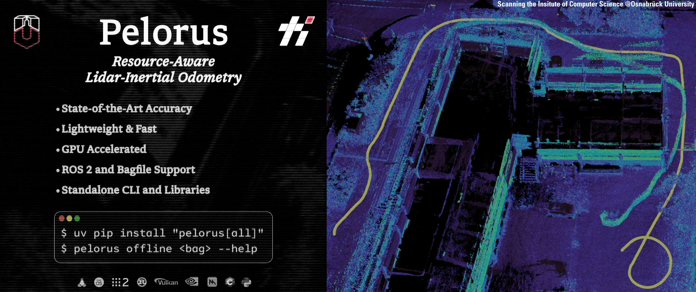

# Pelorus

**Resource-Aware Lidar-Inertial Odometry**, written in Rust, CUDA, Vulkan and Metal. Developed by the Computer Engineering Group at Osnabrück University.

[](#license)
[](https://pelorus.steado.tech/docs/)

Supporting various 3D lidar sensors, IMUs, odometry sources and kinematic models, Pelorus provides real-time performance on embedded hardware while pushing state-of-the-art accuracy. The online mode reaches more than 20 Hz odometry on a Jetson Orin Nano with a 128-layer Ouster lidar, keeping resource usage low so the rest of your application has room to run.

Scale your compute down to single-core CPU usage or up to full parallel compute on CPU and **GPU**, supporting NVIDIA, AMD, Intel and Apple Silicon.



## Ways to use

Pick whichever fits your stack. All of them support both CPU-only and GPU-accelerated setups:

| | |
|---|---|
| **[ROS 2 package](https://pelorus.steado.tech/docs/ros/)** | Drop-in integration for existing ROS 2 systems |
| **[Standalone CLI](https://pelorus.steado.tech/docs/standalone/)** | Offline and online modes, no ROS required |
| **[C / C++ library](https://pelorus.steado.tech/docs/standalone/)** | CMake integration with Eigen and PCL helpers |
| **[Python package](https://pelorus.steado.tech/docs/standalone/)** | Published on PyPI for quick prototyping and offline processing |
| **[GLIM plugin](https://pelorus.steado.tech/docs/glim/)** | Odometry source for [GLIM](https://koide3.github.io/glim/) mapping |

## ROS 2 quick start

First, install **[Rust](https://www.rust-lang.org/tools/install)** if you haven't already.

Pelorus builds with your standard **ROS 2 CMake** toolchain.

<details>
<summary>Set up the PPA</summary>

Add the [steado PPA](https://ppa.steado.tech/).

```sh
curl -fsSL "https://ppa.steado.tech/ubuntu/key.gpg" | gpg --dearmor \
  | sudo tee /usr/share/keyrings/steado-archive-keyring.gpg >/dev/null
echo "deb [arch=$(dpkg --print-architecture) signed-by=/usr/share/keyrings/steado-archive-keyring.gpg] https://ppa.steado.tech/ubuntu $(. /etc/os-release && echo $UBUNTU_CODENAME) main" \
  | sudo tee /etc/apt/sources.list.d/steado.list
sudo apt update
```

</details>

```sh
# available for Humble, Jazzy and Lyrical
sudo apt install ros-$ROS_DISTRO-pelorus

# make a config and change the values to your needs, e.g. topic names, frame ids, sensor parameters etc.
ros2 run pelorus pelorus config generate recommended > pelorus.rl

# now launch
ros2 launch pelorus pelorus.launch.py config_path:=pelorus.rl rviz:=false
```

## Standalone quick start

```sh
uv pip install "pelorus[all]"
```

Generate a config, then run it against a recorded MCAP bag:

```sh
pelorus config generate recommended > pelorus.rl

pelorus offline path/to/your.mcap -c pelorus.rl
```

See the [standalone docs](https://pelorus.steado.tech/docs/standalone/) for pulling sample bags with [Marina](https://marina.steado.tech/docs/), running Zenoh/ROS-compatible middleware, and visualizing results with Rerun or RViz.

Please see the **[docs](https://pelorus.steado.tech/docs/)** for more info about ROS, standalone usage, libraries, [sensor/IMU calibration](https://pelorus.steado.tech/docs/calibration/) and [configuration](https://pelorus.steado.tech/docs/configuration/).

## Development

See [CONTRIBUTE.md](CONTRIBUTE.md) for setting up a development environment with `mask` and `rerun`.

## License

Pelorus is dual-licensed under [MIT](LICENSE-MIT) or [Apache-2.0](LICENSE-APACHE), at your option.
