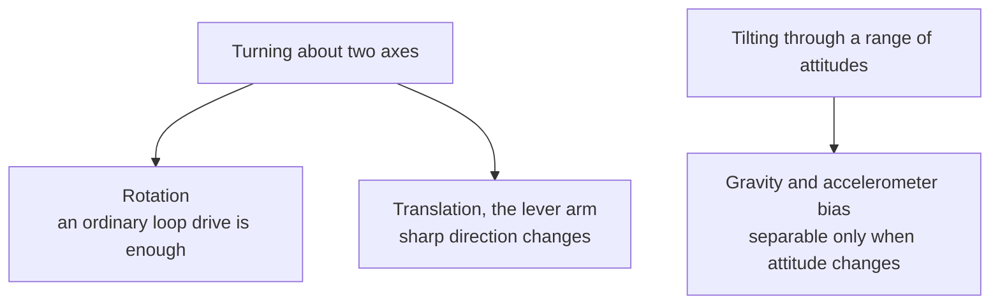

# LiDAR to IMU extrinsics

The transform has to be measured against a trajectory that did not already assume it. Pelorus runs a LiDAR-inertial odometry, so feeding its poses back would return the assumption instead of measuring it. Run it LiDAR only first:

```sh
pelorus offline calib_drive -c pelorus.rl -o imu.lidar_only=true -o output.mcap.rosbag_dir=lidar_traj
dedrunk extrinsics lidar_traj --imu-bag calib_drive
```

[`imu.lidar_only`](../configuration/reference/imu.md#imu-lidar-only) ignores the IMU and propagates the filter at a constant twist between scans. Deskewing, the voxel map and the registration are unchanged, so the trajectory is as good as your normal tuning makes it. It also ignores `imu.from_lidar_transform`, because without an IMU there is nothing for that transform to point at.

This is not a navigation mode. With no IMU the gravity direction is unobservable, so roll and pitch end up relative to wherever the sensor started. The covariances also stop describing sensor noise and start describing how far the constant twist model can be trusted, so raise them.

dedrunk prints the result as configuration you can paste straight in:

```ratslang
imu.calibration.time_offset = -0.005900s
imu {
  from_lidar_transform {
    translation = [0.0379m, -0.0480m, 0.1972m]
    rotation = [ [+0.999995, -0.001268, +0.003056],
                 [-0.001272, -0.999998, +0.001479],
                 [+0.003055, -0.001483, -0.999994] ]
  }
}
```

## What the recording has to contain

This is where an extrinsic calibration goes wrong. The two halves of the transform need different motion, and so do gravity and the accelerometer bias.



**Rotation** needs the platform to turn about at least two axes. An ordinary drive around a loop is enough, so this half works on data you already have.

**Translation**, the lever arm, enters the model only through `S(ẇ) + S(w)²`. Without rotation the IMU and the LiDAR accelerate identically and their separation leaves no trace at all. Rotation about an axis makes the lever arm components perpendicular to it observable and leaves the one along it invisible. Rotate briskly, because the term goes with `w²` and sharp direction changes are worth more than sustained turning.

**Gravity and the accelerometer bias** enter as `−R·Cᵀ·g` and `+b_a`, so separating them needs the attitude to change enough that `Cᵀ·g` swings around the body frame. That means tilting the platform. Turning on the spot does nothing for it, because a robot that stays level holds `Cᵀ·g` almost constant, and the fit then has no way to attribute a constant acceleration to one or the other.

A wheeled robot on flat ground satisfies the first requirement and fails the third, which is the case most people hit.

## Reading the diagnostics

Look at these before you look at the numbers:

```
gravity:      [+0.723, +0.239, -6.267] m/s^2  (|g| = 6.313)
residuals:    acceleration 4.126 m/s^2
attitude spread:                       2.1°  (separates gravity from accel bias)
angular excitation (rms, LiDAR frame): [0.030, 0.037, 0.143] rad/s
```

Treat the fitted gravity as a check on the recording. dedrunk fits it as a free vector so that its magnitude can be compared against 9.81. If it is off, everything the accelerometer contributed is worthless together, which means the translation, the gravity vector and the accelerometer bias:

```
warning: the fitted gravity is 6.31 m/s^2 against an expected 9.81, off by 36%...
warning: the platform's attitude varies by only 2.1° over the recording, so gravity
and the accelerometer bias cannot be told apart...
```

The rotation and the time offset come from the gyroscope alone and survive this untouched, so both are worth taking from a recording whose accelerometer half failed. On a real loop drive with a wheeled robot the rotation came out within 0.2° of the surveyed mounting while the translation was unusable, which is the normal outcome for that recording.

To get the translation, record a couple of minutes with the sensor head tilted through a range. Lift it off the robot if you can, and roll and pitch it as well as yaw it. Aim for `|g|` near 9.81 and no warnings.

## The time offset

[`imu.calibration.time_offset`](../configuration/reference/imu.md#imu-calibration-time-offset) is the constant skew between the two sensors' clocks, meaning how far the IMU's timestamps run ahead of the LiDAR's for the same physical instant. Pelorus subtracts it from every IMU timestamp as the sample enters, before anything reads that time, so the integration step, the undistortion window and the scan pairing all agree.

!!! warning "Paste the number exactly as dedrunk prints it, sign included"

    Getting the sign backwards doubles the skew instead of removing it. The
    symptom is slightly smeared scans while turning, which looks like a
    registration problem, which is the wrong place to look.

It matters in proportion to how fast you turn. At 1 rad/s, 10 ms of skew drags the scan through about half a degree, which the registration then has to absorb on every frame. Standing still it costs nothing, so a bad offset can pass unnoticed on a gentle dataset and still ruin an aggressive one.

Unlike the transform, this comes out of the gyroscope alone, so it is trustworthy from the same ordinary drive that gives you the rotation. No tilting required.

## Refining online

If you already have a good extrinsic, from CAD or from the procedure above, the filter can keep refining it while it runs:

```ratslang
imu.from_lidar_transform.estimate_online = true
```

This refines an extrinsic you already have. It cannot produce one, because it needs a starting guess close enough to converge, and the extrinsic is only observable while the platform is being excited. On a robot that mostly drives straight it will drift along the unobservable directions, so check the result against what you started with.
