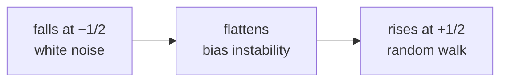

# Noise densities and random walks

These four numbers describe how much of the IMU signal is noise. Two are white noise densities and two are bias random walks.

They are never applied to a measurement. Noise is irreducible, and a value you do not know sample by sample cannot be subtracted. What they do is tell the filter how far to trust the IMU between LiDAR corrections. Too small and the filter rides the IMU through a corner and ignores the scan match. Too large and it throws away good inertial information.

## Recording

Park the robot, start the recording, and leave the room. Three hours is the practical minimum and longer is better. The sensor has to be genuinely undisturbed for all of it. A nearby fan, a compressor cycling, or somebody walking past on a suspended floor is enough to spoil the long end of the curve. A basement slab is a better surface for this than a workshop bench.

```sh
pelorus online raw imu --output-rosbag imu_static
```

The `imu` argument matters. Three hours of IMU at 400 Hz is a couple of gigabytes, while three hours with the LiDAR running is closer to a hundred and none of it would be used. It also leaves the LiDAR socket closed, so the machine is doing nothing that could vibrate the sensor.

Recording runs until you stop it with ++ctrl+c++. Confirm afterwards with `dedrunk topics imu_static` that you got the whole thing.

## Computing

```sh
dedrunk noise imu_static -o output.path='"imu_noise.yaml"'
```

That is the whole procedure.

```
/imu/data: 4320000 samples over 10800.0 s (400.0 Hz)

accelerometer_noise_density: 2.027539e-3
accelerometer_random_walk:   9.985073e-4
gyroscope_noise_density:     3.053876e-4
gyroscope_random_walk:       2.169208e-4
update_rate:                 400.00 Hz

written to /home/you/imu_noise.yaml
Allan deviation curves in allan.csv
```

dedrunk reads the values off the Allan deviation the same way Kalibr and `allan_variance_ros` do. White noise comes from the `−1/2` slope at `τ = 1 s` and the bias random walk from the `+1/2` slope at `τ = 3 s`, so the numbers are directly comparable with anything else in that ecosystem. The estimator is streaming and keeps running accumulators per cluster time instead of the samples, so a 24 hour recording costs no more memory than a ten minute one.

## When it refuses

dedrunk warns below three hours. When the curve does not contain the slope it needs, it refuses to produce a number:

```
error: the Allan deviation of the accelerometer x axis has no clear slope +0.5 region
(0 point(s) spanning 0.0x in tau, need 4 spanning 1.5x). Either the recording is too
short to reach the bias random walk, or this sensor does not show one over the cluster
times covered
```

Two things cause that. Either the recording is too short, because the random walk only emerges at cluster times of tens of seconds and you need hours to average enough of them, or the cluster range does not reach far enough:

```sh
dedrunk noise imu_static -o noise.cluster.max=3000s
```

Keep `noise.cluster.max` below a tenth of the recording length. Past that there are too few independent clusters for the estimate to mean anything, and dedrunk says so.

## Checking the curve

`allan.csv` has one row per cluster time, with a column per axis:

```
tau,accel_x,accel_y,accel_z,gyro_x,gyro_y,gyro_z,pairs
```

Plot the axis columns against `tau` on log-log axes and read the shape of the curve. A healthy one has three parts:



Both sloped regions have to be present and reasonably long. A curve that only ever falls means there is no measurable random walk over the range covered. Bumps, or a rise that starts early, usually mean the sensor was disturbed and the recording is not usable. The three axes should look similar, and one that stands out is worth investigating before you use the averaged value.

## Without hours to spare

Datasheet figures are a legitimate fallback. Manufacturers usually quote white noise as **angular random walk** for the gyroscope and **velocity random walk** for the accelerometer, which are the same quantities under different names. Bias figures are rarer, and **in-run bias instability** is the usual stand-in. Write them into a Kalibr file by hand and merge as usual.

Expect them to be optimistic. The Kalibr wiki suggests inflating measured densities by a factor of ten or more for low-cost MEMS parts, and datasheet values need at least as much.
