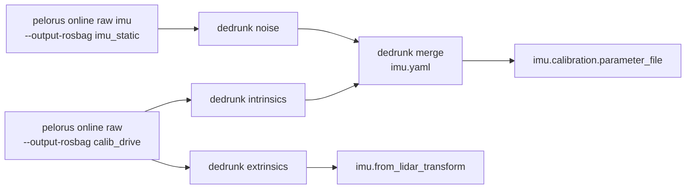

# Calibration

Pelorus assumes three things about your IMU that are not true out of the box. It assumes the axes are square and correctly scaled, that you know how noisy the device is, and that you know where it sits relative to the LiDAR. Each is a separate measurement, and each one fails quietly.

None of it is mandatory. A well mounted sensor pair produces a usable trajectory on the defaults. Calibration is what removes the drift that tuning will not remove.

| Measurement | Command | Recording |
| --- | --- | --- |
| [Scale, axis misalignment, bias](imu-intrinsics.md) | `dedrunk intrinsics` | Minutes, the sensor held still in many orientations |
| [Noise densities and bias random walks](imu-noise.md) | `dedrunk noise` | Hours, the sensor completely undisturbed |
| [LiDAR to IMU transform](extrinsics.md) | `dedrunk extrinsics` | Minutes of driving, turning and tilting |

The first two describe the IMU on its own and the third describes the pair. They can be done in any order, but the extrinsic fit is cleaner once the intrinsics are applied.

[dedrunk](https://github.com/stelzo/dedrunk) performs all three measurements. It reads MCAP recordings and writes Kalibr format YAML, which Pelorus reads back through [`imu.calibration.parameter_file`](../configuration/reference/imu.md#imu-calibration-parameter-file) and [`imu.from_lidar_transform`](../configuration/reference/imu.md#imu-from-lidar-transform).

```sh
cargo install --path <checkout>/dedrunk
```

## Recording



Intrinsics and extrinsics both need a recording containing both sensors, and dedrunk tells the topics apart by message type, so one ordinary drive covers both. Noise wants a recording of its own, described on its [own page](imu-noise.md).

```sh
pelorus online raw --output-rosbag calib_drive
dedrunk topics calib_drive
```

The first command publishes on the normal topics and records at the same time, so nothing else in your stack has to change. The second lists what landed. Both an `.mcap` file and a ROS 2 bag directory work as input, so `--output-mcap` is equally fine.

!!! warning "The IMU topic has to carry raw device output"

    `pelorus online raw` publishes exactly what the driver reported, with no AHRS
    filtering applied. Never calibrate against `imu/filtered` or any other topic
    that has been through an orientation filter.

## Applying the result

The intrinsic and the noise halves live in one file. Merge them once both exist and point Pelorus at the result.

```sh
dedrunk merge imu_intrinsics.yaml imu_noise.yaml -o output.path='"imu.yaml"'
```

```ratslang
imu.calibration {
    parameter_file = "./imu.yaml"

    # Bias moves with temperature and between power cycles, so the stored value
    # is the least reliable part of the file. Measure it at start-up instead.
    gyroscope = true
    samples = 100
}
```

Keep the robot stationary for the first second after start-up. Those samples measure the gyroscope bias and are never published.

### Covariances from the file

Once the file carries the noise half, Pelorus can derive the four `imu.covariance_*` values from it instead of using the shipped constants:

```ratslang
imu.calibration {
    noise_from_file = true
    noise_inflation = 10.0
}
```

This is off by default. `Q` is sandwiched with `dt²` in the propagation, so it holds discrete time variances, `(density × inflation)² × update_rate`. The inflation cannot be derived. Allan variance is measured on a still sensor at constant temperature, while a moving robot adds vibration, thermal drift and timing jitter on top.

Pelorus logs the derived and the configured values side by side at start-up:

```
IMU covariances from ./imu.yaml (inflation 10x): gyroscope 1.800e-3 (was 1.000e-1),
acceleration 8.000e-2 (was 1.000e-1), gyroscope bias 8.000e-6 (was 1.000e-4),
acceleration bias 3.200e-3 (was 1.000e-4)
```

The four ratios are not consistent with each other. The gyroscope term lands 55 times below the shipped constant while the accelerometer bias lands 32 times above it. The defaults Pelorus inherits are FAST-LIO tuning values and not one consistent noise model, so no single inflation reproduces them. Switch this on against a bag whose answer you already know and compare trajectories before adopting it.
