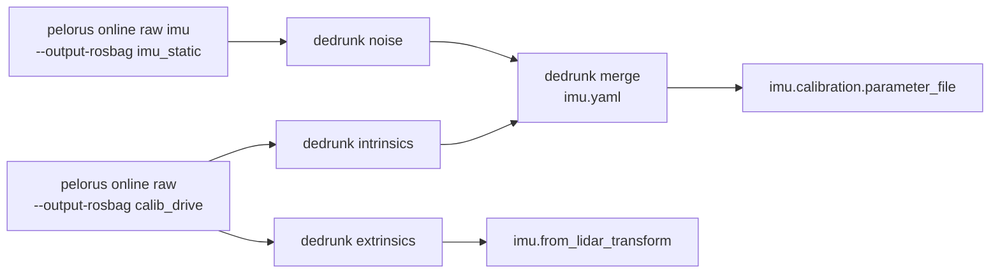

# Calibration

Calibration is optional. Pelorus produces a usable trajectory on the defaults with a well mounted sensor pair. Calibrating the IMU removes drift that tuning cannot.

| Measurement | Command | Recording |
| --- | --- | --- |
| [Scale, axis misalignment, bias](imu-intrinsics.md) | `dedrunk intrinsics` | Minutes, sensor held still in many orientations |
| [Noise densities and bias random walks](imu-noise.md) | `dedrunk noise` | Hours, sensor completely undisturbed |
| [Lidar to IMU transform](extrinsics.md) | `dedrunk extrinsics` | Minutes of driving, turning and tilting |

The steps can be done in any order. The extrinsic fit is cleaner with the intrinsics already applied.

[dedrunk](https://github.com/stelzo/dedrunk) does all three. It reads MCAP recordings and ROS 2 bags and writes Kalibr format YAML. It ships with `pelorus[all]` and the Homebrew package, and installs on its own with `cargo install dedrunk`.

## Recording



One recording with both sensors covers intrinsics and extrinsics. Noise needs a [separate long recording](imu-noise.md).

```sh
pelorus online raw --output-rosbag calib_drive
dedrunk topics calib_drive
```

`pelorus online raw` publishes on the normal topics while recording, so the rest of your stack keeps working. `dedrunk topics` lists what was recorded. `--output-mcap` works as well.

!!! warning "Calibrate against raw IMU output"

    `pelorus online raw` records the driver output without AHRS filtering. Never
    calibrate against `imu/filtered` or any other topic that went through an
    orientation filter.

## Applying the result

Merge the intrinsics and noise files and point Pelorus at the result:

```sh
dedrunk merge imu_intrinsics.yaml imu_noise.yaml -o output.path='"imu.yaml"'
```

```ratslang
imu.calibration {
    parameter_file = "./imu.yaml"

    # Measure the gyroscope bias at start-up instead of trusting the file.
    gyroscope = true
    samples = 100
}
```

Keep the robot still for the first second after start-up while the gyroscope bias is measured.

### Covariances from the file

Pelorus can derive the four `imu.covariance_*` values from the noise half of the file instead of using the defaults:

```ratslang
imu.calibration {
    parameter_file.use_noise = true
    noise_inflation = 10.0
}
```

This is off by default. Measured noise comes from a still sensor, so `noise_inflation` scales it up to account for vibration and temperature changes on a moving robot. Pelorus logs the derived and the configured values at start-up. Compare trajectories on a recording you know before switching this on for good.
