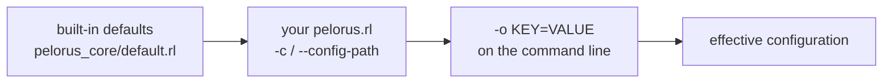

# Configuration

Pelorus is configured with a single [Ratslang](https://ratslang.steado.tech/docs/) file. The binary ships the complete default configuration, so a file of your own only has to carry what differs from it.



Each stage wins over the one to its left. Anything you leave out keeps its default, so most configuration files are short.

## Generating a file

```sh
# prepend 'ros2 run pelorus' if you only have the ROS 2 package installed
pelorus config generate recommended > pelorus.rl
```

This writes the [starter configuration](recommended.md), which holds the options that depend on your hardware or on what you want out of the run. `pelorus config generate full` writes every option instead, which is useful to read but unwieldy to maintain.

For editing, there is a Ratslang extension for VS Code and plugins for Neovim and Helix.

## Validating

```sh
pelorus config verify pelorus.rl
```

Nothing printed means the file is valid. The path defaults to `pelorus.rl`, and `-` reads from standard input. Pelorus runs the same validation at start-up, where a problem either stops the run or produces a warning. Running it yourself catches mistakes earlier.

Unknown keys are an error. Pelorus checks the whole file, types and units included, when it loads it, so an invalid configuration never reaches the pipeline.

## Overriding a single value

Any key can be overridden on the command line. The flag is repeatable and takes Ratslang syntax, units included:

```sh
pelorus offline my_bag -c pelorus.rl \
  -o registration.map.resolution=0.25m \
  -o output.odometry_rate=ImuAndLidar
```

Overrides are applied after the file, so they win over both the file and the defaults. This is the right way to sweep a parameter without editing the file between runs.

## Writing values

| Kind | Examples |
| --- | --- |
| Length | `50cm`, `1.5m`, `-6.253mm` |
| Duration | `20ms`, `1s`, `0s` |
| Range | `1m..3m`, `4m..`, `..2m`, `..` for no limit at either end |
| Number | `4`, `10.0`, `131072` |
| Boolean | `true`, `false` |
| String | `"/ouster/points"`, `""` |
| Enumeration | `Reliable`, `NoTimestamp`, written without quotes |
| Vector | `[0.0m, 0.0m, 0.0m]`, `[1.0, 0.0]` |
| Matrix | `[ [1.0, 0.0, 0.0], [0.0, 1.0, 0.0], [0.0, 0.0, 1.0] ]` |

Blocks can be written nested or as a dotted path, whichever reads better:

```ratslang
registration.map.resolution = 50cm

registration {
  map {
    resolution = 50cm
  }
}
```

## Where to look next

- The [starter configuration](recommended.md) is what `pelorus config generate recommended` writes, with the comments intact.
- The [reference](reference/index.md) documents every option, generated from the same file the binary embeds.
- [Calibration](../calibration/index.md) covers the IMU options whose values have to be measured.
