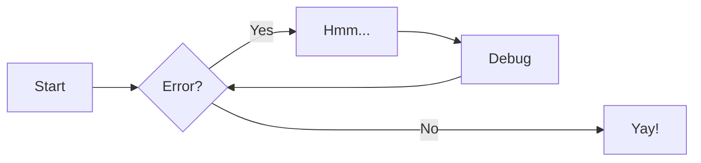

# Introduction

**Pelorus** is a high efficient *Lidar Inertial Odometry*, written in Rust and CUDA and developed by the Computer Engineering Group at the Osnabrück University.

The online mode provides more than 20 Hz odometry on an Jetson Orin Nano with an 128-layer Ouster Lidar while keeping resource consumption to a minimum. Pelorus aims to *just run* in the background so the main application can use the resources for the actual task at hand.

You can run Pelorus on embedded devices (like the NVIDIA Jetson series) as well as on desktop systems with or without GPUs.

This first release is a public beta with binaries only. The source code will be published in the near future alongside the paper.

## First look

Gifs und so

## Getting started

Pelorus is a fully functional LIO system that is meant to be used in real-world applications.

We provide multiple ways to use Pelorus for different use-cases. Each one supports CPU-only systems as well as GPU-accelerated setups:

- **[ROS 2 package]()** for easy integration in existing ROS 2 systems
- **[Standalone C library]()** with CMake integration and C++ bindings (including helpers for Eigen and PCL) for custom applications
- **[Python package]()** published on PyPI for easy prototyping and offline processing
- **[Standalone CLI]()** with offline and online modes
- **[GLIM odometry plugin]()** for easy and accurate mapping

[GLIM](https://koide3.github.io/glim/)
There is a ROS 2 package:
"youtube demo" or a few gifs?


offline mode using [Minot](https://uos.github.io/minot) for bagfile handling, rerun for visualization and [ratpub] as pub/sub middleware.


For full documentation visit [zensical.org](https://zensical.org/docs/).

## Commands

* [`zensical new`][new] - Create a new project
* [`zensical serve`][serve] - Start local web server
* [`zensical build`][build] - Build your site

  [new]: https://zensical.org/docs/usage/new/
  [serve]: https://zensical.org/docs/usage/preview/
  [build]: https://zensical.org/docs/usage/build/

## Examples

### Admonitions

> Go to [documentation](https://zensical.org/docs/authoring/admonitions/)

!!! note

    This is a **note** admonition. Use it to provide helpful information.

!!! warning

    This is a **warning** admonition. Be careful!

### Details

> Go to [documentation](https://zensical.org/docs/authoring/admonitions/#collapsible-blocks)

??? info "Click to expand for more info"
    
    This content is hidden until you click to expand it.
    Great for FAQs or long explanations.

## Code Blocks

> Go to [documentation](https://zensical.org/docs/authoring/code-blocks/)

``` python hl_lines="2" title="Code blocks"
def greet(name):
    print(f"Hello, {name}!") # (1)!

greet("Python")
```

1.  > Go to [documentation](https://zensical.org/docs/authoring/code-blocks/#code-annotations)

    Code annotations allow to attach notes to lines of code.

Code can also be highlighted inline: `#!python print("Hello, Python!")`.

## Content tabs

> Go to [documentation](https://zensical.org/docs/authoring/content-tabs/)

=== "Python"

    ``` python
    print("Hello from Python!")
    ```

=== "Rust"

    ``` rs
    println!("Hello from Rust!");
    ```

## Diagrams

> Go to [documentation](https://zensical.org/docs/authoring/diagrams/)



## Footnotes

> Go to [documentation](https://zensical.org/docs/authoring/footnotes/)

Here's a sentence with a footnote.[^1]

Hover it, to see a tooltip.

[^1]: This is the footnote.


## Formatting

> Go to [documentation](https://zensical.org/docs/authoring/formatting/)

- ==This was marked (highlight)==
- ^^This was inserted (underline)^^
- ~~This was deleted (strikethrough)~~
- H~2~O
- A^T^A
- ++ctrl+alt+del++

## Icons, Emojis

> Go to [documentation](https://zensical.org/docs/authoring/icons-emojis/)

* :sparkles: `:sparkles:`
* :rocket: `:rocket:`
* :tada: `:tada:`
* :memo: `:memo:`
* :eyes: `:eyes:`

## Maths

> Go to [documentation](https://zensical.org/docs/authoring/math/)

$$
\cos x=\sum_{k=0}^{\infty}\frac{(-1)^k}{(2k)!}x^{2k}
$$

!!! warning "Needs configuration"
    Note that MathJax is included via a `script` tag on this page and is not
    configured in the generated default configuration to avoid including it
    in a pages that do not need it. See the documentation for details on how
    to configure it on all your pages if they are more Maths-heavy than these
    simple starter pages.

<script id="MathJax-script" async src="https://unpkg.com/mathjax@3/es5/tex-mml-chtml.js"></script>
<script>
  window.MathJax = {
    tex: {
      inlineMath: [["\\(", "\\)"]],
      displayMath: [["\\[", "\\]"]],
      processEscapes: true,
      processEnvironments: true
    },
    options: {
      ignoreHtmlClass: ".*|",
      processHtmlClass: "arithmatex"
    }
  };
</script>

## Task Lists

> Go to [documentation](https://zensical.org/docs/authoring/lists/#using-task-lists)

* [x] Install Zensical
* [x] Configure `zensical.toml`
* [x] Write amazing documentation
* [ ] Deploy anywhere

## Tooltips

> Go to [documentation](https://zensical.org/docs/authoring/tooltips/)

[Hover me][example]

  [example]: https://example.com "I'm a tooltip!"
