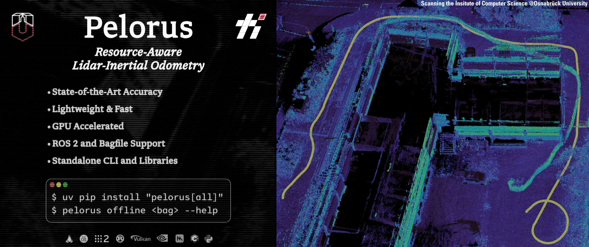
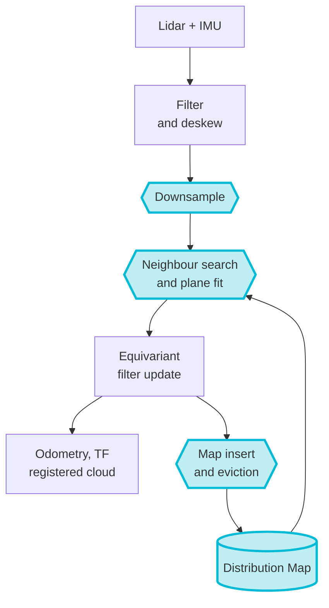

# About

**Pelorus** is a Resource-aware Lidar-Inertial Odometry written in Rust with optional GPU support for NVIDIA, AMD, Apple and Intel. It is developed and maintained by the [Computer Engineering Group](https://www.uni-osnabrueck.de/fb6/informatik/en/research-groups/computer-engineering) at Osnabrück University.

The online mode delivers more than 20 Hz odometry on a Jetson Orin Nano with a 128-layer Ouster LiDAR while keeping resource consumption to a minimum. Pelorus is meant to run in the background so that the main application can use the machine for the task at hand. It runs on embedded devices such as the NVIDIA Jetson series and on desktop systems with or without a GPU.


## How to run

For a quick start, install the following package containing the CLI, Python library, playback and visualization tools.

```bash
uv pip install "pelorus[all]"
```

In a real scenario, Pelorus can run in several ways: 

| | |
| --- | --- |
| **[ROS 2 package](ros.md)** | Drop-in integration for existing ROS 2 systems |
| **[Standalone CLI](standalone.md)** | Offline and online modes, no ROS required |
| **[C and C++ library](standalone.md#c-and-c-library)** | CMake integration, with helpers for Eigen and PCL |
| **[Python package](standalone.md#python)** | On PyPI, for prototyping and offline processing |
| **[GLIM plugin](glim.md)** | Odometry source for [GLIM](https://koide3.github.io/glim/) mapping |

Prebuilt packages for Ubuntu, PyPI, Homebrew and the AUR, and release archives, are listed under [installation](install.md).

All you need to run Pelorus now is the dataset and a configuration for your sensors and topics. For this demo, we will provide everything for you. Pelorus uses SeaKit by default for all its tooling. 

The dataset can be downloaded with `marina`, which was installed with the Pelorus package.

```bash
marina pull wachsbleiche/parking_25:hunter
```

Now we can run the method.
```bash
# optional gui visualization
rerun

# in other terminal
pelorus offline wachsbleiche/parking_25:hunter \
    -c $(marina resolve wachsbleiche/parking_25:hunter)/pelorus.rl \
    -o output.rerun=true
```

Pelorus will run the odometry as fast as possible through the offline pipeline. You can go back in time in the GUI to view real-time results. You can get there by selecting "sensor_time" and choose "1x" speed.

Sometimes you'll want to see more than just the odometry. You can enable the local map visualization by appending `-o output.rerun.map=true` to the above command. Mind that this will slow down the process. Even more so when running with GPU acceleration.

The local map visuals are meant for debugging [local map sizes](configuration/reference/registration.md#registration-map-capacity), since Pelorus' local map (and Pelorus in general) is intended for localization, not mapping. This is odometry after all. For pretty maps with global consistency, you can use the [GLIM plugin](glim.md) or wait for the release of our full SLAM in the coming weeks.


## Architecture

<!-- Two things here are deliberate and easy to undo by accident.

     The highlight fill is translucent. The theme colours mermaid labels with
     .nodeLabel { color: var(--md-mermaid-label-fg-color) }, which is dark in
     the light scheme and light in the dark one, and it wins over anything a
     classDef sets. A translucent fill composites over the page behind it, so
     the theme's own label colour stays readable in both schemes. A solid fill
     needs a fixed label colour to match, which is the fight that left the text
     unreadable in dark mode. The stroke carries the emphasis instead.

     Keep the diagram to plain mermaid. A YAML frontmatter config block at the
     top stopped it rendering on the page altogether, leaving the source
     showing as a code block. -->



Everything highlighted can run on the GPU. Each of those stages has a CUDA, a Vulkan and a Metal implementation next to its CPU one. A GPU binary runs the same pipeline at the same accuracy.

The map holds a [fixed number of voxels](configuration/reference/registration.md#registration-map-capacity)
and evicts using a least-relevance criterion. Memory is therefore bounded by configuration. That is what makes a long run on a Jetson predictable.

The state is estimated through an [iterated equivariant kalman filter](https://arxiv.org/abs/2409.06948). Wheel odometry or kinematic constraints can be added for additional constraints, which helps most where the geometry is degenerate, such as a long corridor. Wheel odometry is still unstable due to a lack of test data.


## Getting started

1. Install Pelorus one of the ways above.
2. Generate a [configuration](configuration/index.md) and set the topics, frame IDs and sensor parameters for your hardware.
3. Run it against a recording before running it on a robot.
4. Once it works, [calibrate the IMU](calibration/index.md). That is what removes the drift tuning will not remove.
